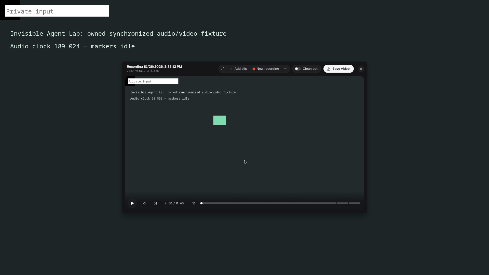

# Klippt

Klippt is a native screen recorder and editor. Record in clips, pause and continue, drop a bad
clip while you record, review the take, then save the untouched source files or one finished video.
Speech-based cleanup ("Clean cut") runs a local Parakeet speech model on your machine; nothing is
uploaded.

Linux is the main platform. macOS also works. It is free, with no account, trial, or telemetry.



## Status

Early and usable. The recorder, review, clip removal, source handoff, and MP4/GIF export work on
Linux (Wayland, PipeWire) and macOS. There is no signed public release yet; build it yourself.

Known limitations:

- Wayland cannot hide Klippt's own windows from a full-display recording. Record a window, or put
  the controls on another display.
- Speech models download on first use of Clean cut (several hundred MB).
- The Windows capture helper exists but is not tested right now.
- Packaged builds check `updates.dyberg.co` for new versions. That is the only automatic
  network call.

## Build and run on Linux

You need Node `22.22.1`, npm `10.9.4`, Rust/Cargo, a C compiler, libclang, EGL/GLES headers, and
patchelf 0.18 or newer. At runtime you need PipeWire, an XDG ScreenCast portal for your desktop,
and a Vulkan driver for the compositor preview. niri uses the GNOME portal backend.

```fish
npm ci
npx install-electron --no
npm run fetch:ffmpeg
npm run build:native:linux
npm run build:native:compositor:linux
npm run dev
```

Packages (AppImage, deb, pacman, rpm): `npm run build:linux`. Output lands in `release/<version>/`.

## Build and run on macOS

You need Xcode command-line tools, Node `22.22.1`, npm `10.9.4`, and Rust/Cargo.

```fish
npm ci
npm run build:native:mac
npm run build:native:parakeet:mac
npm run fetch:ffmpeg:mac
npm run build:native:compositor:mac
npm run dev
```

`npm run build:mac` makes a DMG; signing and notarization need your own Apple Developer ID. See
[`technical-documentation/engineering/build-and-packaging.md`](technical-documentation/engineering/build-and-packaging.md).

## Checks

```fish
npx tsc --noEmit
npm run lint
npm run test
```

## More

- [`CONTRIBUTING.md`](CONTRIBUTING.md): how to send a change.
- [`AGENTS.md`](AGENTS.md): product and engineering rules.
- [`technical-documentation/`](technical-documentation/README.md): architecture and testing.

## License

Copyright (C) 2026 Olle Dyberg. Licensed under the GNU Affero General Public License v3.0 only;
see [`LICENSE`](LICENSE).

Klippt started from [OpenScreen](https://github.com/getopenscreen/openscreen), which is MIT
licensed. Its notice is kept in
[`third-party-licenses/OpenScreen-MIT.txt`](third-party-licenses/OpenScreen-MIT.txt). Bundled
components and their licences are listed in [`THIRD-PARTY-NOTICES.md`](THIRD-PARTY-NOTICES.md).
