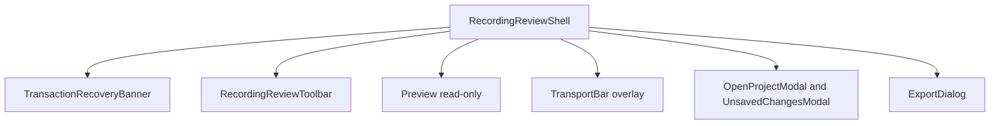

# Editor shell

Klippt is recording-only. The editor window is the recording review shell,
[`RecordingReviewShell.tsx`](../../src/components/ai-edition/RecordingReviewShell.tsx), mounted by
[`AiEditionShell.tsx`](../../src/components/ai-edition/AiEditionShell.tsx). It opens after Stop to
watch the take, record again, add a clip, open earlier recordings, and export.

The inherited editor (top bar, floating inspector, timeline, media workspace, and their panes)
was removed on 2026-10-05. It is recoverable from the `archive/pre-cleanup-2026-10-05` tag.
[`productSurface.ts`](../../src/lib/productSurface.ts) still pins `recordingOnly` to `true`.

## Current component tree

The toolbar's Record and Add clip actions hide the window and open the recorder HUD. The
recorder hands the take back through `recordingImport.ts`, and the shell restores the playhead
from the persisted `RecordingWorkspaceContext`. That context keeps its `mode`, `inspectorOpen`,
and `facet` fields for compatibility with the main process; review always writes `edit`, `true`,
and `effects`.

## State ownership

`RecordingReviewShell` owns transport wiring, seek requests, modal state, the export lock, and
the recording hand-off flags. [`useProjectStore`](../../src/lib/ai-edition/store/projectStore.ts)
owns the loaded document and project persistence.
[`useAssetDimensionBackfill`](../../src/lib/ai-edition/store/useAssetDimensionBackfill.ts) probes
and persists missing source dimensions once per asset.

The preview receives the document sources plus zoom, speed, Full Camera, and trim regions, read
directly from the document by
[`reviewPreviewRegions.ts`](../../src/components/ai-edition/reviewPreviewRegions.ts). Projects
edited before review became the only shell keep rendering their regions. Annotations and zooms
are drawn by the native compositor from the same document. The preview is read-only: review
offers no framing, webcam drag, or region editing.

## Preview and export

Preview and export consume the same document intent, but they use separate output budgets. Preview
renders at the visible CSS size. Export renders at the selected output resolution and quality. Do
not make export resolution depend on the preview viewport.

MP4 and GIF export use the native compositor through
[`ExportDialog.tsx`](../../src/components/ai-edition/ExportDialog.tsx) and
[`compositorViewClient.ts`](../../src/native/compositorViewClient.ts). Multi-clip export projects
project-time regions into each clip's source-time span. Review opens the dialog in quick-export
mode; the Originals action opens untouched source recovery.

## UI authorities

[`src/styles/design-tokens.css`](../../src/styles/design-tokens.css) is the production token
authority. Shared selects, menus, popovers, tooltips, and dialog wrappers live under
[`src/components/ui/`](../../src/components/ui/). Do not add raw HTML selects or local accent colors
to review surfaces.

The current project state, verification evidence, and remaining beta gates live in
[`HANDOFF.md`](../../HANDOFF.md).
