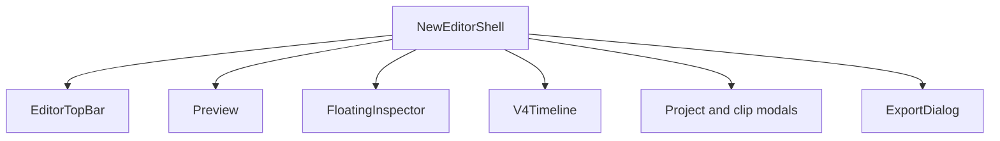

# Editor shell

The current Klippt alpha uses
[`NewEditorShell.tsx`](../../src/components/ai-edition/NewEditorShell.tsx) as the owner of the
editor surface. The shell mounts the top bar, preview stage, floating inspector, timeline, project
modals, and export dialog.

[`productSurface.ts`](../../src/lib/productSurface.ts) is the release-surface switchboard. The
current alpha keeps the inherited media workspace, AI chat, and captions hidden. Transcript is the
only optional inherited facet that is visible. Hidden code keeps document compatibility, but it is
not part of the normal user flow.

## Current component tree

The top bar exposes one visible workspace: **Edit**. Recording starts from its Record action and
then moves to the separate recorder HUD and camera-preview windows. Recording is not a third editor
mode.

The inherited `MediaStage` path remains in code behind `PRODUCT_SURFACE.mediaWorkspace`. The
inherited `LeftPanel` chat remains behind `PRODUCT_SURFACE.agentEditor`. Keep these paths hidden
unless a planned product slice explicitly restores them.

## State ownership

`NewEditorShell` owns the active workspace, transport state, inspector state, modal state, preview
seek target, and timeline height. [`useProjectStore`](../../src/lib/ai-edition/store/projectStore.ts)
owns the loaded document and project persistence. [`useTimeline`](../../src/lib/ai-edition/store/useTimeline.ts)
owns clip and timeline-region mutations.

The preview receives the document sources plus zoom, speed, camera-emphasis, annotation, and trim
regions. Preview framing changes use live state during a drag and commit once when the gesture ends.
This keeps interaction smooth and keeps undo history useful.

## Inspector facets

[`FloatingInspector.tsx`](../../src/components/ai-edition/v4/FloatingInspector.tsx) defines these
facets:

| Facet | Purpose | Current alpha |
| --- | --- | --- |
| Background | Canvas color, image, blur, padding, and presentation | Visible |
| Effects | Screen presentation and motion controls | Visible |
| Layout | Aspect ratio, screen framing, and camera layout | Visible |
| Cursor | Cursor appearance and motion | Visible |
| Audio | Clean Voice, loudness, and pause analysis | Visible |
| Automatic | Automatic-direction settings and presets | Visible |
| Captions | Caption appearance and translation | Hidden |
| Transcript | Transcript review, language, and copy actions | Visible |

When the user selects a timeline region, the selection pane replaces the facet body. The selection
pane edits the real region value. User changes must promote an automatic region to manual ownership
so regeneration does not remove the correction.

## Timeline

[`V4Timeline.tsx`](../../src/components/ai-edition/v4/V4Timeline.tsx) renders clips, the ruler,
playhead, audio waveform, and visible edit regions. Timeline positions use project-time seconds.
Fixed visual affordances use pixels and convert to time through the current pixels-per-second value.
This rule keeps clip edges, pills, and the playhead aligned on long recordings and at every zoom
level.

The timeline remains mounted below the editor preview. Background analysis can continue when the
user switches inspector facets. The app must not start pause analysis only because the Audio facet
opened.

## Preview and export

Preview and export consume the same document intent, but they use separate output budgets. Preview
renders at the visible CSS size. Export renders at the selected output resolution and quality. Do
not make export resolution depend on the preview viewport.

MP4 and GIF export use the native compositor through
[`ExportDialog.tsx`](../../src/components/ai-edition/ExportDialog.tsx) and
[`compositorViewClient.ts`](../../src/native/compositorViewClient.ts). Multi-clip export projects
project-time regions into each clip's source-time span.

## UI authorities

[`src/styles/design-tokens.css`](../../src/styles/design-tokens.css) is the production token
authority. Shared selects, menus, popovers, tooltips, and inspector wrappers live under
[`src/components/ui/`](../../src/components/ui/). Do not add raw HTML selects or local accent colors
to editor surfaces.

The current project state, verification evidence, and remaining beta gates live in
[`HANDOFF.md`](../../HANDOFF.md).
