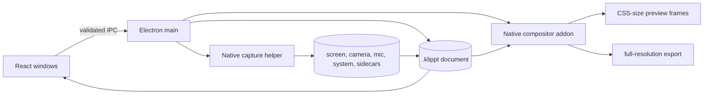

# Architecture overview

Klippt is an Electron, React, and TypeScript screen recorder with a review window and native media
helpers. The main process lives in `electron/`. The Vite renderer starts at `src/App.tsx` and
selects a window surface from `?windowType=`.

The editor UI, the in-app LLM chat, the `klippt agent` editing CLI, automatic direction, and
speech-to-text were archived on 2026-10-05; the last source with them is the tag
`archive/pre-cleanup-2026-10-05`. Windows and Linux capture code stays for later ports.

## Runtime surfaces

- `editor` — the recording review window ([editor-shell.md](editor-shell.md)).
- `hud-overlay` — the floating recording controller.
- `camera-preview` — the preview-only confidence monitor.
- `source-selector` — the screen and window picker.
- `countdown-overlay` — the recording pre-roll.
- `showNotes=true` — the separate notes surface.

Production surfaces load from `klippt://app/index.html`. Development uses the configured Vite
origin. Every BrowserWindow keeps context isolation, sandboxing, and `webSecurity` enabled. The
main process denies unexpected navigation, webviews, and child windows.

## Process and media boundaries



The main process owns window lifecycle, trusted IPC, opaque media grants, recording orchestration,
project persistence, entitlement state, update state, and atomic export publication. Renderer code
does not receive arbitrary filesystem access.

Native capture helpers own the time-sensitive platform work:

- macOS uses Swift, ScreenCaptureKit, AVFoundation, and AVAssetWriter.
- Windows uses C++, Windows Graphics Capture, WASAPI, and Media Foundation.
- Linux uses Rust plus a C PipeWire shim and the desktop portal.

The Rust compositor owns preview composition and export rendering through the
`compositor_view.node` N-API boundary. It uses platform GPU paths such as Metal and D3D11. The
preview pulls bounded RGBA frames at the visible CSS size. Export resolves its own output size and
does not inherit the preview cap.

## Project source of truth

`AxcutDocument` is the internal schema name. Schema version 9 is the current project source of
truth. New projects use `.klippt`. Legacy `.openscreen` and `.axcut` files remain readable and are
copied forward after validation without deleting the original.

The renderer holds one current document in the Zustand project store. Timeline clips, trim ranges,
Screen Zoom, Camera Emphasis, transcript words, layout, audio policy, captions, and export settings
live in that document. Review edits only clips; projects from earlier releases keep their stored
regions, captions, and annotations, and preview and export still render them. Project writes go through the main-process document
service, use revision checks where supported, and publish atomically.

Modifiers stay clip-anchored in source time. The timeline projects them into playback time after
cuts. Preview and export consume the same scene mapping so trim, clip reorder, focus, and camera
layout do not need parallel render models.

## Recording flow

```text
idle HUD -> setup -> countdown -> clip 1 -> Pause -> clip 2 -> Stop -> review window
```

Pause finalizes the current fragmented MP4 clip while the logical session stays active. Continue
starts a new writer. Remove previous clip updates project state without deleting recoverable media.
Stop persists the kept clips and returns to the review window at the saved insertion boundary.

Microphone and system audio roles remain explicit. The mixed audio track exists for compatibility,
not as the preferred analysis source. Cursor and privacy-safe interaction timing remain sidecars
next to the recording.

## Security boundary

`electron/ipc/trustedRendererIpc.ts` rejects privileged IPC unless it comes from the trusted
top-level frame and expected `webContents`. `electron/localMediaProtocol.ts` maps opaque grants to
canonical approved paths and supports bounded byte-range media reads. Permission handlers validate
the trusted origin and recording/setup role. Production fuses disable RunAsNode, production Node
options, and CLI inspect, and require the integrity-checked ASAR.

## Where to go next

1. [document-model.md](document-model.md) — schema, migration, and persistence.
2. [timeline-model.md](timeline-model.md) — time systems and clip-anchored regions.
3. [recording.md](recording.md) — HUD and native capture lifecycle.
4. [preview.md](preview.md) — native frame delivery and playback sync.
5. [export-pipeline.md](export-pipeline.md) — scene rendering and atomic publication.
6. [native-bridge.md](native-bridge.md) — typed renderer/main boundary.
7. [decisions.md](decisions.md) — settled and rejected architecture choices.

Use [`../../HANDOFF.md`](../../HANDOFF.md) for the live branch, evidence, risks, and next action.
